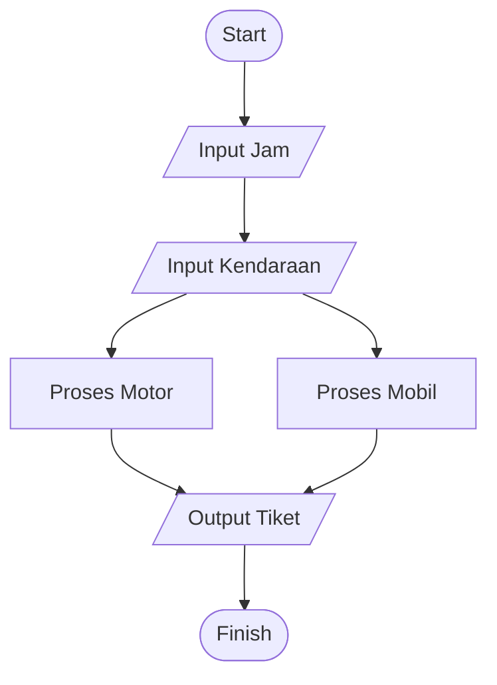
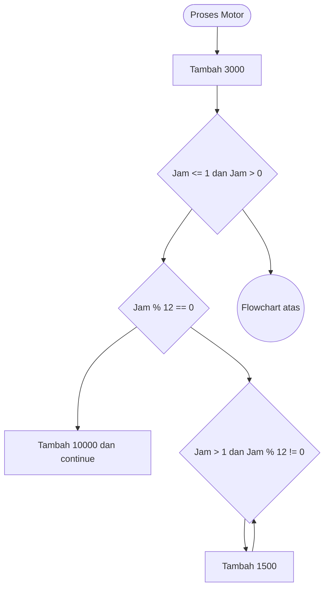
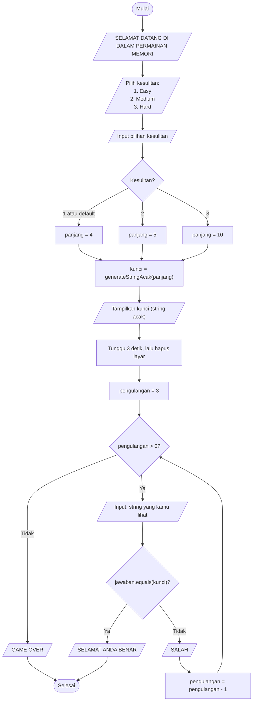

## Flow Control

1. Branch, Digunakan untuk memilih perintah mana yang akan dijalankan berdasarkan ondisi tertentu
2. Loop

Tugas
Membuat percangan dan pengulangan

Diselesaikan denaan bahasa Java
Kasus: Bayar total parkir
Input Jam
Ada pilihan kendaraan Mobil dan Motor

- Untuk mobil 1 jam pertama Rp5.000
- Jam setelahnya akan ditambah Rp3.000/jam
- Setiap 12 jam mendapatkan charge tetap Rp.20.000

- Untuk motor 1 jam pertama Rp2.000
- Jam setelahnya akan ditambah Rp1.500/jam
- Setiap 12 jam mendapatkan charge tetap Rp.10.000

Hasil yang dikeluarkan berupa tiket parkir beserta total harga dan jam.

Case Test:
Jam = 2, Kendaraan = Mobil, Output = Rp8000
Jam = 10, Kendaraan = Motor, Output = Rp15500
Jam = 13, Kendaraan = Mobil, Output = Rp58000
Jam = 24, Kendaraan = Motor, Output = Rp53500
Jam = 0, Kendaraan = Motor, Output = Rp0

Dikasih ke kelompok 3

Soal
Studi Kasus:
Buatlah program game memori yang dimana ada angka dan huruf acak yang akan menghilang dalam jangka waktu tertentu.
3 string huruf dan angka acak = [18QP.,06IO.,99JEE] nantinya variabel ini akan menghilang dan user diminta kembali untuk menulis apa yang sebelumnya dilihat setelah itu jawaban user dibandingkan dengan soal yang ditampilkan sebelumnya apakah benar atau tidak. Case Sensitive.

